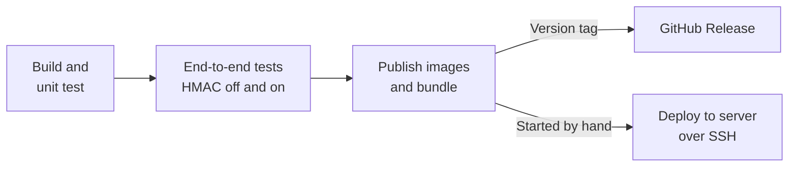

# Inventory Hold Microservice

Places temporary holds on inventory during checkout, so items in a customer's cart can't be sold to anyone else. Holds expire after a configurable duration and their stock returns automatically.

Built with .NET 10, MongoDB, Redis, RabbitMQ and React/TypeScript.

## Getting started

Docker is the only requirement.

```bash
docker-compose up --build
```

| What | Where |
|---|---|
| Web app | http://localhost:3000 |
| API | http://localhost:8080 |
| OpenAPI document | http://localhost:8080/openapi/v1.json |
| RabbitMQ management | http://localhost:15672 (`inventory` / `inventory-dev-only`) |

MongoDB, Redis and RabbitMQ are published on `127.0.0.1` only, so they can't be reached from other machines.

Compose works with no configuration. To change a setting, copy `.env.example` to `.env`.

To watch holds expire without waiting 15 minutes:

```bash
HOLD_DURATION_MINUTES=0.25 HOLD_SWEEP_INTERVAL_SECONDS=5 docker-compose up --build
```

### Running the tests

```bash
dotnet test
```

The unit tests mock the repositories, cache and publisher, so they need no running infrastructure.

To check the running stack end to end (status codes, real race conditions against MongoDB, expiry, Redis, RabbitMQ):

```bash
node scripts/e2e-check.mjs
```

On Windows, clone to a short path such as `C:\src\inventory-hold`. A long parent folder can push build output past the 260-character path limit, which fails with `MSB3030: Could not copy the file`.

### Running outside Docker

Start the infrastructure with `docker-compose up mongo redis rabbitmq`, then:

```bash
dotnet run --project src/InventoryHold.WebApi
```

```bash
cd frontend && npm install && npm run dev
```

For this mode, set `RabbitMq__UserName` and `RabbitMq__Password` to match compose, or change them in `appsettings.json`.

## API

| Endpoint | Success | Errors |
|---|---|---|
| `POST /api/holds` | 201 with `Location` | 400 invalid request, 404 unknown SKU, 409 insufficient stock |
| `GET /api/holds/{id}` | 200 (an expired hold is 200 with status `Expired`) | 404 |
| `DELETE /api/holds/{id}` | 200 | 404, 409 already released, 410 expired |
| `GET /api/inventory` | 200 | |
| `GET /api/holds?status=Active` | 200 | 400 invalid status |
| `GET /health` | 200 | |

The first four are the brief's required endpoints. `GET /api/holds` is the one addition: the Active Holds List needs it, because the alternative (the browser remembering hold IDs) would hide holds placed in any other browser. `GET /health` serves the container healthcheck.

Errors are RFC 7807 ProblemDetails with a machine-readable `code`:

```json
{
  "status": 409,
  "title": "Insufficient stock",
  "detail": "Not enough stock for SKU 'CM-4K-05' to hold 10.",
  "code": "insufficient_stock",
  "sku": "CM-4K-05",
  "requested": 10
}
```

## Architecture

See [doc/architecture.md](doc/architecture.md) for diagrams of the system, the code layers, the main request flows, the data model, events and request signing.

```
src/
├── InventoryHold.Contracts/       Requests, responses, enums, event payloads
├── InventoryHold.Domain/          Services (HoldService), repository and cache/publisher
│                                  interfaces, entities, validation, exceptions
├── InventoryHold.Infrastructure/  MongoDB, Redis and RabbitMQ implementations
├── InventoryHold.WebApi/          Controllers, error mapping, expiry sweeper, Program.cs
└── InventoryHold.UnitTests/       NUnit + Moq
frontend/                          Vite + React + TypeScript + TanStack Query
scripts/e2e-check.mjs              End-to-end check against the running stack
deploy/                            Production compose file and deployment script
.github/workflows/pipeline.yml     Build, test, publish and deploy
```

Dependencies point inward: WebApi → Infrastructure → Domain → Contracts. All business rules are in `HoldService`, which knows only interfaces.

## Design decisions

### Data model

- **`products`**: `_id` (SKU), `name`, `available`, `held`. Tracking `held` separately means the total on hand stays visible and a discrepancy can be spotted.
- **`holds`**: `_id`, `customerId`, `status`, embedded `lines`, `createdAt`, `expiresAt`, `closedAt`. Lines are embedded because they belong to the hold and are always read with it. Product names are copied in so a hold still reads correctly if a product is renamed.
- **`inventory_units`**: `_id` (serial number), `sku`, `holdId`, `lotNumber`, `condition`, `receivedAt`, `lastUpdatedAt`. One document per physical unit of a serial-tracked product; a null `holdId` means it is free.

So inventory has two levels: `products` holds the catalogue details and the counts, and `inventory_units` holds each item. `GET /api/inventory` returns both, with a product's items in its `units` array.
- Closed holds are kept, not deleted, as an audit record.
- Persistence classes are separate from domain entities, so the domain has no MongoDB dependency.

### Item details

These fields extend the existing responses, with no new endpoints. Where each one lives follows what it describes:

| Field | Belongs to | Why |
|---|---|---|
| `partNumber`, `manufacturer` | Product | The manufacturer's identifier for the item. `sku` is this business's own, and several SKUs can share one part number |
| `category`, `unitOfMeasure` | Product | Describes the item |
| `warehouseLocation` | Product | A simplification: one bin per product. Real stock can sit in several, which would need stock per location |
| `reorderPoint`, `lowStock` | Product | `lowStock` is true when `available` is at or below `reorderPoint` |
| `isSerialized` | Product | High-value items are tracked per unit. Cheap accessories are only counted, because recording a serial for each isn't worth the cost |
| `serialNumbers` | Hold line | A serial identifies one physical unit, so it's assigned when that unit is held, never stored on the product |
| `approxShipDate` | Hold line and inventory | The hold keeps the date quoted to the customer. Inventory shows what an order placed now could expect, or null when sold out |
| `lastUpdatedAt` | Product and unit | Set by MongoDB's `$currentDate` in the same atomic update that moves the stock, so it can't drift from the change it records |
| `lotNumber`, `condition`, `receivedAt` | Unit | Describes one physical item. The seeded values are sample data |

**Trade-off:** returning `units` inside `GET /api/inventory` keeps the API to the agreed endpoints, and suits this catalogue of 58 items. With tens of thousands of items, this response would be too large to poll, and items should move to a paged `GET /api/inventory/{sku}/units`.

**Serial numbers.** The atomic stock count still decides whether a hold succeeds. Only then are that many specific units claimed, each with its own atomic `findOneAndUpdate`, so no two holds can get the same serial. Releasing or expiring a hold frees its units first and then restores the count, so a count never promises a unit that isn't free yet. Units are claimed in serial order; a real warehouse might use first-in-first-out by receipt date.

**Ship dates** are estimates: the order date (the next business day after the `ShippingCutoffHourUtc` cutoff), plus the product's handling days, skipping weekends. Public holidays and carrier transit time aren't modelled, which is why the field is "approximate".

### Concurrency

Stock is reserved with one conditional update:

```js
updateOne({ _id: sku, available: { $gte: qty } },
          { $inc: { available: -qty, held: qty } })
```

The check and the deduction are a single atomic operation on one document, so two requests can't both claim the same units. There is no read-then-write gap to race through.

- **Multi-item holds** reserve lines in sorted SKU order. If any line fails, the lines already reserved are returned and the request gets a 409.
- **Closing a hold** goes through a compare-and-set, `findOneAndUpdate({ _id, status: "Active" }, ...)`. However many callers race (a double-clicked release, a release against the sweeper, several API instances), one gets the document back. Only that caller restores stock and publishes, so stock can't be restored twice.
- **Client disconnects:** once stock has moved, the service stops honouring the request's cancellation token, so an aborted request can't leave stock reserved with no hold recording it.

### Why not multi-document transactions?

Transactions would make "deduct stock + insert hold" all-or-nothing, but MongoDB requires a replica set for them, which adds startup machinery for the sake of a narrow failure case.

**Known limitation:** if the process dies between two steps, stock can be left out of step with holds. For example, a crash after reserving stock but before saving the hold leaves those units, and any serial numbers claimed for them, held with no owner. Failed restores are logged at Critical with the hold, SKU and quantity for reconciliation. For production I'd move to a replica set with transactions, or add a reconciliation job comparing `held` against active holds.

### Expiry

Two paths share one `ExpireAsync`:

- **`HoldExpirySweeper`** runs every 30 seconds by default, and returns stock for holds nobody asks about again.
- **Lazy detection** on GET, DELETE and list means nobody sees an out-of-date Active hold between sweeps.

A MongoDB TTL index isn't used: it would delete the hold without restoring stock or emitting `HoldExpired`.

Stock from an expired hold becomes available within one sweep interval, unless a request touches the hold sooner. So a hold can tie up stock for up to 30 seconds past its expiry.

### Caching

| Read path | Strategy | TTL | Why |
|---|---|---|---|
| `GET /api/inventory` | Cache-aside, invalidated on every stock change | 30s | Highest read volume; every open dashboard polls it |
| `GET /api/holds/{id}` | Cache-aside, invalidated on every transition | min(60s, time until expiry) | Checkout polls its own hold |
| `GET /api/holds` | Not cached | | Low volume and must be fresh |

- **Stock decisions never use the cache.** The atomic update in MongoDB decides, so stale cache data can show a slightly wrong number but can't cause overselling.
- **A cached Active hold past its expiry isn't trusted.** The service rechecks `expiresAt` on every hit and goes to the database.
- **Fail-open:** if Redis is down, reads fall back to MongoDB and a warning is logged. The client is set to `BacklogPolicy.FailFast`; its default queues commands during an outage, which stalled each request for about 11 seconds when tested.
- **Versioned keys:** cache keys include a schema version, bumped whenever a cached response changes shape, so a redeploy never reads entries in the old format.
- **Known race:** a reader that misses the cache can write back a value just after a concurrent mutation invalidated it. The TTLs bound how long that lasts.

### Messaging

A durable topic exchange `inventory.holds` with routing keys `hold.created`, `hold.released` and `hold.expired`, so a consumer can bind to only what it needs. A durable queue `inventory-hold.events` binds to `hold.#` so that events can be inspected in the management UI; a real consumer would declare its own queue.

```json
{
  "eventId": "6f1c...",
  "eventType": "HoldCreated",
  "occurredAt": "2026-01-01T12:00:00+00:00",
  "holdId": "b1e2...",
  "customerId": "customer-1",
  "items": [{
    "sku": "MN-27-4K",
    "productName": "27-inch 4K Monitor",
    "partNumber": "VD-27U4K-IPS",
    "quantity": 2,
    "approxShipDate": "2026-01-07",
    "serialNumbers": ["MN-27-4K-00001", "MN-27-4K-00002"]
  }],
  "expiresAt": "2026-01-01T12:15:00+00:00",
  "schemaVersion": 1
}
```

Events carry everything a consumer needs, so it needn't call back. Messages are persistent and use publisher confirms. `eventId` lets consumers de-duplicate.

**Known limitation:** events are published after the MongoDB write, and a publish failure is logged rather than failing the request, because the hold has already been committed. A broker outage therefore loses those events, and each create or release can also take up to `PublishTimeoutSeconds` (5s) while the publish attempt fails. The fix is a transactional outbox, which needs the same replica set as above and would also take publishing out of the request path.

### Frontend

TanStack Query is the state management. Nearly all of this app's state is server state, so a general store such as Redux would mean hand-writing the caching, loading flags and refetching that it provides. Local form state stays in `useState`.

The interface uses [MUI](https://mui.com) (Material UI, MIT licence) with a custom theme in `frontend/src/theme.ts`, including light and dark modes that follow the system setting by default. Selecting a product opens a side panel listing each of its items, with search by serial, lot or hold ID. The panel reads from the same query as the table, so it stays current as holds change.

- Both mutations refresh inventory and holds together, since every hold change moves stock. They refresh on failure too, because a 409 or 410 means this client's view was out of date.
- Holds also expire on the server with no action here, so both lists poll every 15 seconds, and the countdown triggers a refresh when it reaches zero.
- nginx serves the app and proxies `/api`, so there is no CORS to configure and no API URL in the bundle.

### Out of scope

User login (per the brief, so `customerId` is taken on trust), a real product catalogue, and idempotency keys on POST. A retried POST currently creates a second hold; for production I'd add an `Idempotency-Key` header.

## Security

The brief doesn't expect authentication, so `docker-compose up` leaves request signing **off**, and its endpoints can be called directly. The code itself defaults to **on**: outside compose and local development, a deployment that forgets the setting stays protected, and won't start without secrets.

### Turning it on

Set these in `.env`, or in the shell. Generate each secret with `openssl rand -hex 32`:

```
HMAC_ENABLED=true
HMAC_WEB_SECRET=...
HMAC_CHECKOUT_SECRET=...
```

The web app keeps working, and unsigned calls to `:8080` now get a 401. To make a signed call by hand:

```bash
HMAC_CHECKOUT_SECRET=... node scripts/signed-request.mjs GET api/inventory
```

To check everything with signing on, run `node scripts/e2e-check.mjs` with `HMAC_CHECKOUT_SECRET` set to the same value.

### How a client signs

HMAC fits because this API's callers are other systems, such as checkout, that can keep a secret. Each client sends four headers: `X-Client-Id`, `X-Timestamp` (Unix seconds), `X-Nonce` (unique per request) and `X-Signature`, the lowercase hex HMAC-SHA256 of:

```
METHOD
PATH_AND_QUERY
TIMESTAMP
NONCE
SHA256_HEX_OF_BODY
```

| Threat | Defence | Response |
|---|---|---|
| Caller without the secret | Signature check, in constant time | 401 `invalid_signature` |
| Altered method, path, query or body | All are part of what's signed | 401 `invalid_signature` |
| Replay of a captured request | Nonce remembered in Redis, set atomically | 401 `replayed_request` |
| Replay long after capture | Timestamp must be within 5 minutes | 401 `stale_timestamp` |
| Probing for client IDs | An unknown client gets the same answer as a bad signature | 401 `invalid_signature` |
| Oversized body | Rejected before hashing | 413 `body_too_large` |

The signature is checked before the nonce, so a caller without a secret can't fill Redis. `/health` and `/openapi` stay open.

### The web app

A secret in the React bundle would be readable by anyone, so the browser doesn't sign. nginx signs on its way to the API (`frontend/sign.js`), reading the secret from its environment so it's never written to disk. nginx also replaces any of these headers a browser sends.

### What this doesn't protect

- **It doesn't identify people.** HMAC proves a request came from a trusted system. Anyone who can open the web app can use it, and one customer could release another's hold. Hold ownership needs user login.
- **If Redis is down, replay protection weakens.** The nonce check fails open so that a cache outage can't stop checkout, leaving the 5-minute timestamp window as the limit. Replayed releases are harmless either way, because a hold can only close once. A replayed create within that window could place an extra hold, which would then expire.
- **It doesn't hide anything.** HMAC proves a request wasn't altered, but anyone on the network can still read it, so production needs TLS in front of this.

### Next steps for production

TLS, MongoDB and Redis passwords, rate limiting, user login with hold ownership, and secrets from a vault with a rotation process. Rotation can already be done without downtime by adding a second client ID.

## CI/CD and deployment

[`.github/workflows/pipeline.yml`](.github/workflows/pipeline.yml) is a GitHub Actions pipeline. It builds and tests every change, and publishes images from `main` and version tags. **It only deploys when you start it by hand**, so a normal push can't change production.



| What triggers it | What runs |
|---|---|
| Pull request | Build, unit tests, end-to-end tests |
| Push to `main` | The above, plus publishing images tagged `sha-abc1234` and `latest` |
| Tag such as `v1.0.0` | The above without `latest`, tagged with the version, plus a GitHub Release |
| **Run workflow** with **deploy** ticked | The above, then deployment to production |

### Exported artifacts

Download these from the **Summary** page of any run, under **Actions**. GitHub keeps them for 90 days by default.

| Artifact | Contents |
|---|---|
| `unit-test-results` | Test results in `.trx` format |
| `e2e-results-hmac-off`, `e2e-results-hmac-on` | End-to-end output and container logs |
| `api-build` | The published .NET API |
| `frontend-build` | The built web app |
| `docker-images` | Both images as files, loadable with `docker load` |
| `deployment-bundle` | `docker-compose.prod.yml`, `deploy.sh` and `.env.example`; also attached to GitHub Releases for tagged versions |

Images are also published to GitHub's container registry as `ghcr.io/abhishek4official/inventoryhold-api` and `-frontend`.

### Setting up deployment

You need a Linux server with Docker and the Compose plugin, which you can reach over SSH.

**1. On the server,** create the folder and its secrets. Generate each secret with `openssl rand -hex 32`:

```bash
sudo mkdir -p /opt/inventory-hold && sudo chown "$USER" /opt/inventory-hold
```

```bash
nano /opt/inventory-hold/.env
```

Put these in that file. `deploy/.env.example` lists the optional settings, such as ports:

```
RABBITMQ_PASSWORD=...
HMAC_WEB_SECRET=...
HMAC_CHECKOUT_SECRET=...
```

**2. Create an SSH key for deployment.** Add its public half to `~/.ssh/authorized_keys` on the server, for a user in the `docker` group.

**3. In the GitHub repository,** go to **Settings > Environments** and create an environment named `production`. Adding yourself as a required reviewer makes every deployment wait for your approval. Then add these environment secrets:

| Secret | Value |
|---|---|
| `DEPLOY_HOST` | The server's address |
| `DEPLOY_USER` | The SSH user |
| `DEPLOY_SSH_KEY` | The private half of the deployment key |
| `DEPLOY_KNOWN_HOSTS` | The output of `ssh-keyscan your-server` |

To use a folder other than `/opt/inventory-hold`, set a `DEPLOY_PATH` environment variable there too.

### Deploying

Go to **Actions > Pipeline > Run workflow**, pick the branch or tag, tick **deploy**, and run it. All the tests must pass before deployment starts.

`deploy.sh` then pulls the new version and waits for every container to be healthy. **If the new version doesn't become healthy, it returns to the previous one and the run fails.** Stored data is kept either way. The web app is served on port 80 and the API on port 8080, and request signing is always on in this setup.

### Going back to an earlier version

On the server, using any tag listed under the repository's **Packages**:

```bash
bash /opt/inventory-hold/deploy.sh sha-abc1234
```

This needs access to the registry. If the images are private, first run `docker login ghcr.io` with a personal access token that has `read:packages`.

### Deploying without GitHub Actions

Download `deployment-bundle` and `docker-images`, and copy them to the server. Then extract the bundle, create `.env` as above, load the images, and deploy without pulling. The images keep their original version tag:

```bash
tar -xzf inventoryhold-deploy-sha-abc1234.tar.gz
```

```bash
docker load -i inventoryhold-api.tar.gz && docker load -i inventoryhold-frontend.tar.gz
```

```bash
SKIP_PULL=1 bash deploy.sh sha-abc1234
```

### Before relying on this in production

This setup doesn't add TLS, so put a reverse proxy with HTTPS in front of it, and restrict the API's port to the systems that need it. The README's [Security](#security) section lists the other next steps. MongoDB's data lives in a Docker volume on one server, so it also needs backups.

## AI usage

See [AI-USAGE.md](AI-USAGE.md).
