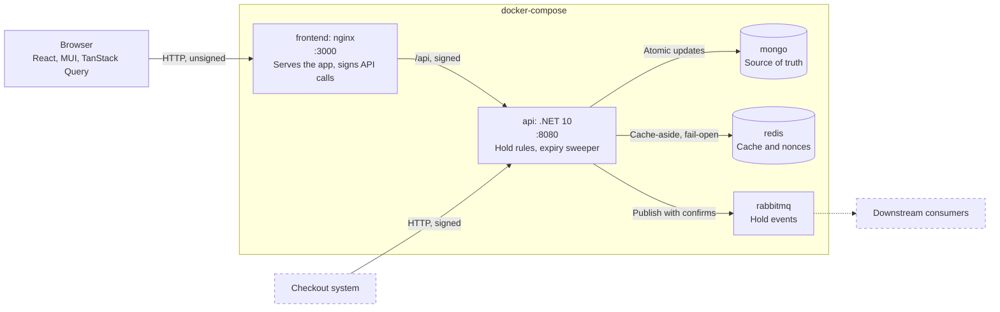
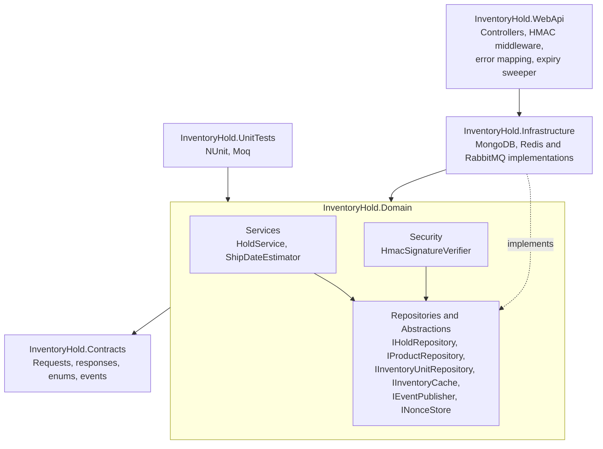
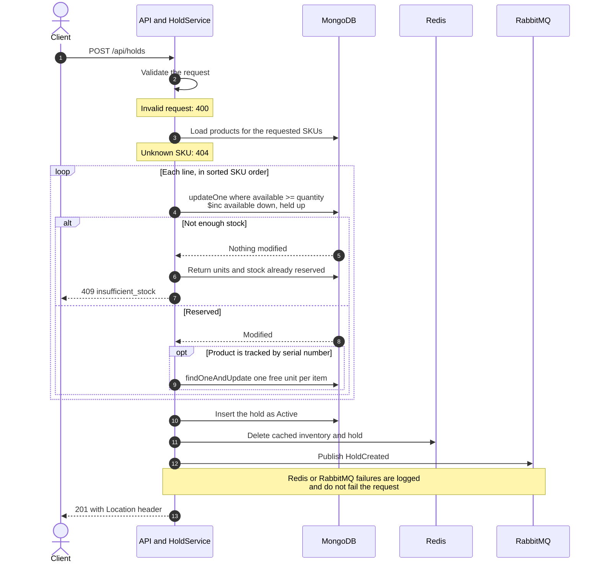
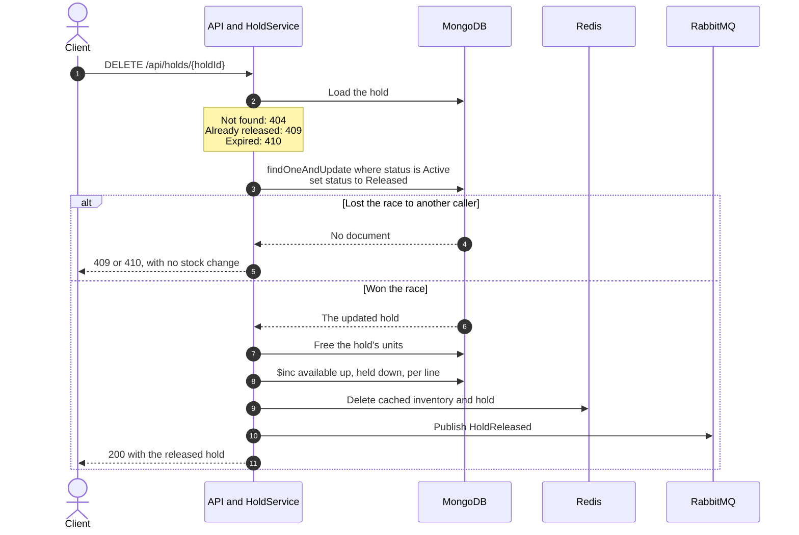
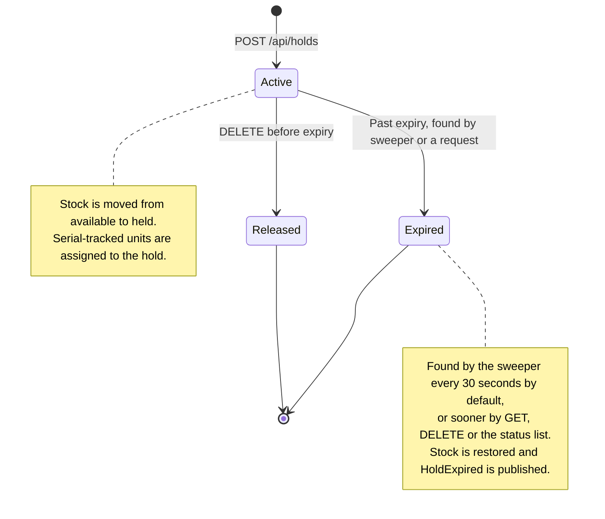
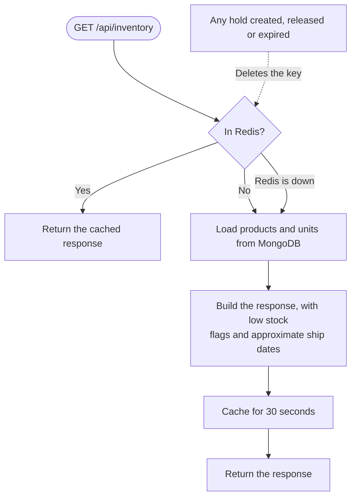
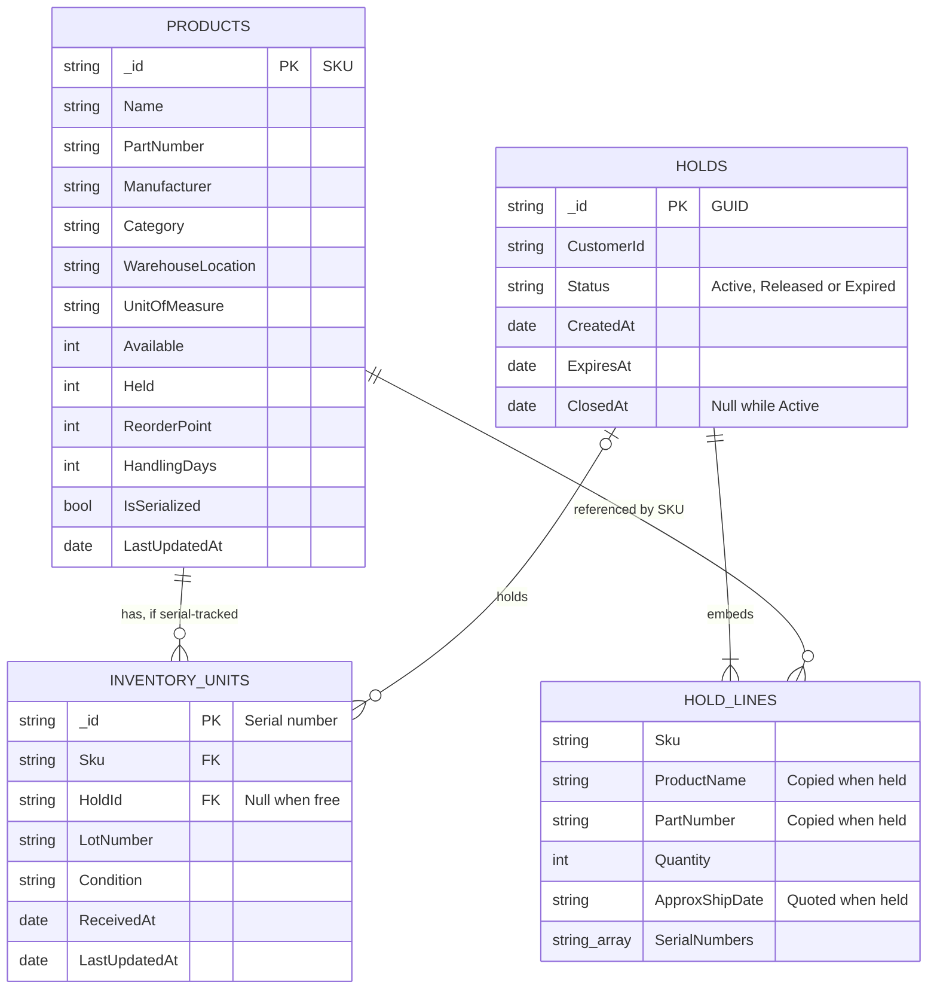
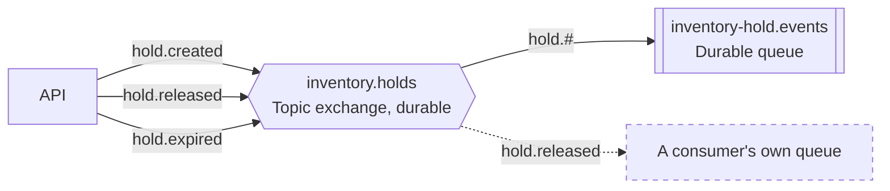
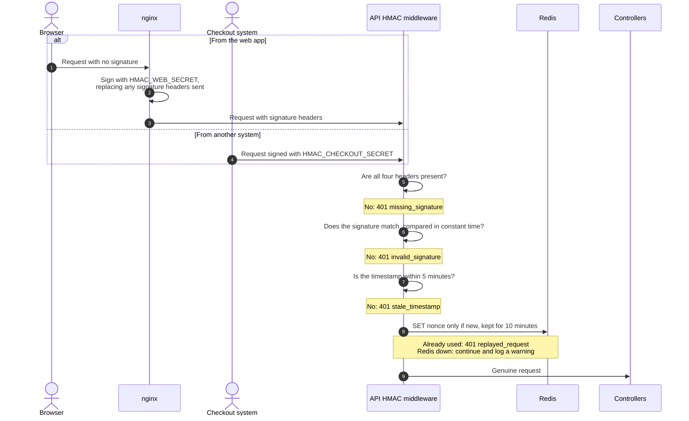

# Architecture

How the Inventory Hold Microservice fits together. For setup and the reasoning behind each decision, see the [README](../README.md).

- [System overview](#system-overview)
- [Code layers](#code-layers)
- [Placing a hold](#placing-a-hold)
- [Releasing a hold](#releasing-a-hold)
- [Hold lifecycle](#hold-lifecycle)
- [Reading inventory](#reading-inventory)
- [Data model](#data-model)
- [Events](#events)
- [Request signing](#request-signing)

## System overview

Five containers start with `docker-compose up --build`. The dashed boxes are outside this repository.



| Service | Host port | Reachable from |
|---|---|---|
| `frontend` | 3000 | Any machine |
| `api` | 8080 | Any machine |
| `mongo` | 27017 | This machine only |
| `redis` | 6379 | This machine only |
| `rabbitmq` | 5672, and 15672 for the management UI | This machine only |

## Code layers

Dependencies point inward. `HoldService` knows only interfaces, so the unit tests can replace every piece of infrastructure with a mock.



## Placing a hold

`POST /api/holds`. The conditional update is what prevents overselling: the stock check and the deduction are one atomic operation on one document.



## Releasing a hold

`DELETE /api/holds/{holdId}`. A compare-and-set on the status is the gate. However many callers race, including the expiry sweeper, only one gets the document back, so stock can't be restored twice.



## Hold lifecycle

A hold moves one way only, and every closed hold is kept as a record.



## Reading inventory

`GET /api/inventory` uses cache-aside. A cached value can be slightly out of date for display, but stock decisions never read the cache, so it can't cause overselling. If Redis is down, the failure is logged and the request carries on using MongoDB.



| Read | Cached for | Cleared by |
|---|---|---|
| `GET /api/inventory` | 30 seconds | Any stock change |
| `GET /api/holds/{holdId}` | 60 seconds, or the time left on the hold if shorter | Any change to that hold |
| `GET /api/holds?status=` | Not cached | Not applicable |

## Data model

Three MongoDB collections. A hold's lines are embedded because they belong to the hold and are always read with it.



## Events

A durable topic exchange lets each consumer bind to only what it needs. The `inventory-hold.events` queue is included so that events can be inspected in the management UI; a real consumer would declare its own queue.



Each event carries everything a consumer needs: `eventId`, `eventType`, `occurredAt`, `holdId`, `customerId`, `items` (SKU, product name, part number, quantity, approximate ship date and serial numbers), `expiresAt` and `schemaVersion`.

## Request signing

Optional HMAC-SHA256 signing, off under `docker-compose` unless `HMAC_ENABLED=true`, and on by default everywhere else. A browser can't keep a secret, so nginx signs on its behalf. See [Security](../README.md#security) for what this does and doesn't protect.



The signature covers these values, one per line:

```
METHOD
PATH_AND_QUERY
TIMESTAMP
NONCE
SHA256_HEX_OF_BODY
```
